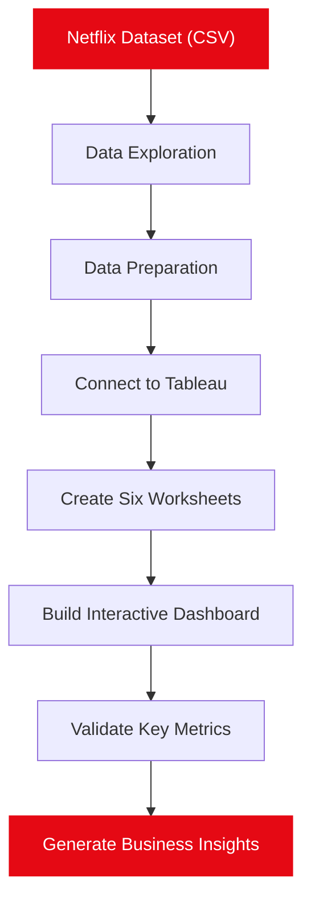

# 🎬 NETFLIX CONTENT ANALYTICS
### Turning Streaming Data into Visual Intelligence

<p align="center">
  
  
  
</p>

<p align="center">
  <b>Explore the Netflix catalogue. Discover patterns. Uncover insights.</b>
  <br/>
  An interactive Business Intelligence dashboard analysing 6,234 movies and TV shows.
</p>

---

## ◈ PROJECT SNAPSHOT

Netflix Content Analytics is a data visualization project designed to transform raw entertainment data into meaningful business insights.

Using Tableau Desktop, this project explores the structure of Netflix's content catalogue through interactive visualizations, geographical analysis, ratings distribution, genre comparisons and yearly content trends.

Rather than navigating thousands of individual records, users can explore the entire analytical story through one consolidated dashboard.

---

## ◈ DASHBOARD PREVIEW

<p align="center">
  
</p>

<p align="center">
  <i>Interactive Netflix Content Analytics Dashboard | Designed in Tableau</i>
</p>

> Replace `assets/dashboard-preview.png` with your actual dashboard screenshot.

---

## ◈ THE NUMBERS BEHIND THE PROJECT

| KEY METRIC | ANALYTICAL RESULT |
|:---|---:|
| Total Titles Analysed | 6,234 |
| Movies | 4,265 |
| TV Shows | 1,969 |
| Countries Represented | 111 |
| Dataset Attributes | 12 |
| Tableau Worksheets | 6 |
| Peak Addition Year | 2019 |

### Catalogue Composition

| Content Type | Distribution |
|:---|---:|
| 🎬 Movies | 68.42% |
| 📺 TV Shows | 31.58% |

---

## ◈ ANALYTICS MODULES

The dashboard consists of six interconnected analytical views.

### 01 — Content Distribution
**Movies vs TV Shows**

A bubble chart comparing movies and television shows by title count and percentage.

**Key Insight:** Movies account for 68.42% of the catalogue.

### 02 — Global Content Intelligence
**Country-Wise Distribution**

A geographical map displaying the number of Netflix titles associated with different countries.

**Leading Markets:**

- United States — 2,032 titles
- India — 777 titles
- United Kingdom — 348 titles
- Japan — 176 titles
- Canada — 141 titles

### 03 — Audience Classification
**Ratings Analysis**

A column chart examining the distribution of content across maturity ratings.

**Key Insight:** TV-MA and TV-14 together represent approximately 59.8% of the catalogue.

### 04 — Genre Intelligence
**Top 10 Genre Categories**

A horizontal bar chart ranking the most frequently occurring genre categories.

**Top Categories:**

- Documentaries — 299
- Stand-Up Comedy — 273
- Dramas with International Movies — 248

### 05 — Catalogue Growth
**Yearly Content Additions**

An area chart illustrating the number of movies and TV shows added over time.

**Key Insight:** 2019 was the peak year, with 2,349 titles added.

### 06 — Title Exploration
**Interactive Detail Panel**

A dynamic information panel displaying selected title details, including:

- Title and content type
- Rating and duration
- Release year and date added
- Genre and description

---

## ◈ TECHNOLOGY STACK

| Technology | Role |
|:---|:---|
| Tableau Desktop | Interactive dashboard development |
| CSV | Dataset storage and connection |
| Mapbox | Map background |
| OpenStreetMap | Geographic map data |
| Tableau Calculations | Aggregation and distinct counting |

---

## ◈ DATA ENGINEERING & PREPARATION

Before visualization, the dataset was explored and prepared to improve analytical consistency.

**Data Preparation Activities**

- Examined missing values across all 12 attributes.
- Converted `Date Added` from text into a date field.
- Assigned geographic roles to the `Country` dimension.
- Organized fields into Tableau Dimensions and Measures.
- Applied sorting and Top 10 filters to genre categories.
- Used distinct title counting for consistent aggregation.

**Primary Tableau Measure**

```text
CNTD([Show Id])
```

This calculation counts unique title IDs rather than summing the numeric identifiers.

---

## ◈ ANALYTICAL WORKFLOW



---

## ◈ KEY BUSINESS INSIGHTS

| Analytical Area | Discovery |
|:---|:---|
| Content Strategy | Movies dominate the catalogue. |
| Geographic Presence | United States leads, followed by India. |
| Audience Classification | TV-MA and TV-14 are the leading ratings. |
| Genre Distribution | Documentaries lead the genre categories. |
| Content Expansion | 2019 recorded the highest additions. |

These findings demonstrate how visualization can simplify large datasets and reveal patterns that are difficult to identify through raw records.

---

## ◈ PROJECT STRUCTURE

```text
Netflix-Content-Analytics/
│
├── assets/
│   └── dashboard-preview.png
│
├── dashboard/
│   └── Netflix_Dashboard.twbx
│
├── dataset/
│   └── netflix_titles.csv
│
├── report/
│   └── Netflix_Project_Report.pdf
│
└── README.md
```

---

## ◈ HOW TO RUN THE PROJECT

**Prerequisites**

- Tableau Desktop or a compatible Tableau application.
- Netflix dataset in CSV format, if not embedded in the packaged workbook.

**Execution Steps**

1. Clone or download this repository.
2. Navigate to the `dashboard` directory.
3. Open `Netflix_Dashboard.twbx` using Tableau.
4. If prompted, reconnect the data source.
5. Explore the worksheets and interactive dashboard.

---

## ◈ CHALLENGES & LEARNINGS

Working with this dataset provided practical experience in:

- Handling missing and incomplete values.
- Converting text-based dates.
- Understanding geographical dimensions.
- Working with multiple values stored in individual fields.
- Choosing suitable visualizations for analytical questions.
- Designing a consistent dashboard interface.
- Validating aggregated results.

---

## ◈ FUTURE ROADMAP

| Enhancement | Objective |
|:---|:---|
| Updated Dataset | Explore more recent catalogue information |
| Advanced Filters | Improve dashboard exploration |
| Genre Normalization | Analyse individual genres separately |
| NLP Integration | Extract themes from title descriptions |
| Recommendation Engine | Explore content similarity |
| Tableau Public | Publish an interactive online dashboard |

---

## ◈ DATASET & REFERENCES

**Dataset:** Netflix Movies and TV Shows

**Source:** Kaggle

https://www.kaggle.com/datasets/shivamb/netflix-shows

**Important:** This project uses a historical dataset snapshot from early 2020. Its findings should not be interpreted as Netflix's current catalogue statistics.

---

## ◈ ABOUT THE CREATOR

<p align="center">
  <b>RIYA RAINA</b>
  <br/>
  MCA | Artificial Intelligence & Machine Learning
  <br/>
  Data Analytics • Business Intelligence • AI/ML
</p>

<p align="center">
  <a href="https://github.com/RiyaRaina1">
    
  </a>
</p>

---

<p align="center">
  <b>DATA IS MORE THAN NUMBERS. IT IS A STORY WAITING TO BE DISCOVERED.</b>
  <br/><br/>
  ⭐ If you find this project interesting, consider giving this repository a star!
  <br/>
  <i>Built with curiosity, analytics and a passion for turning data into insights.</i>
</p>
